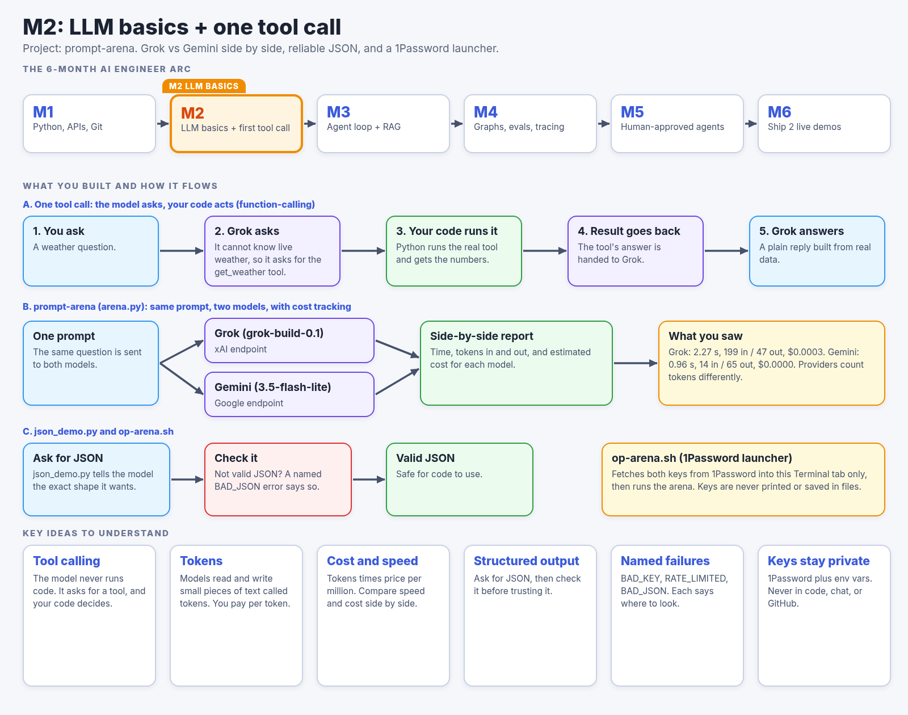

# prompt-arena

Send one prompt to two LLM APIs, Grok (xAI) and Gemini (Google), and compare the answers side by side: the text, how long each took, how many tokens were used, and the estimated cost.

## Where this fits



```
Grok (grok-build-0.1)                       Gemini (gemini-3.5-flash-lite)
----------------------------------------    ----------------------------------------
<answer>                                    <answer>

Time: 2.27s                                 Time: 0.96s
Input tokens: ...                           Input tokens: ...
Output tokens: ...                          Output tokens: ...
Cost: $...                                  Cost: $...
```

## Files

| File | What it does |
| --- | --- |
| `arena.py` | The live comparison. Asks both models the same question and prints the results side by side. |
| `test_arena.py` | Offline tests for `arena.py`. They use fake answers, so no network and no keys are needed. |
| `json_demo.py` | Gets reliable JSON out of Grok: parses the reply, and retries once with a stricter prompt if it isn't valid JSON. |
| `test_json_demo.py` | Offline tests for `json_demo.py` (valid JSON, JSON in markdown fences, invalid JSON that triggers the retry). |
| `op-arena.sh` | Launcher that reads both keys from 1Password and runs `arena.py`. |

## Setup

You need Python 3.10 or newer.

```bash
python3 -m venv .venv
.venv/bin/pip install openai google-genai pytest
```

Then give the scripts your two API keys. Keys are read from environment variables and are never printed. Don't commit them.

**Option A: environment variables** (set in the same Terminal tab you run from):

```bash
export XAI_API_KEY="your-xai-key"
export GOOGLE_API_KEY="your-google-key"
```

**Option B: 1Password.** Install the [1Password CLI](https://developer.1password.com/docs/cli/), sign in with `eval $(op signin)`, and store each key as an item named `xAI API Key` and `Google API Key` in a vault called `Personal`, in a field called `credential`. `op-arena.sh` reads them with `op read`.

## Run

```bash
./op-arena.sh                      # keys from 1Password
.venv/bin/python arena.py          # keys from environment variables
.venv/bin/python arena.py "Your own prompt here"
.venv/bin/python json_demo.py      # reliable JSON demo (needs XAI_API_KEY)
```

## Run the tests

```bash
.venv/bin/python -m pytest test_arena.py
.venv/bin/python -m pytest test_json_demo.py
```

## Models and rough prices

| Model | Input per 1M tokens | Output per 1M tokens |
| --- | --- | --- |
| Grok `grok-build-0.1` (via the OpenAI-compatible API at `https://api.x.ai/v1`) | $1.00 | $2.00 |
| Gemini `gemini-3.5-flash-lite` | $0.10 | $0.40 |

Cost is estimated as `(input_tokens * input_price + output_tokens * output_price) / 1,000,000`. Prices change, so check each provider's pricing page. The two providers count tokens differently, so compare token numbers loosely.

## When something goes wrong

Failures have names and plain-English messages instead of raw stack traces:

- `MISSING_KEY`: an API key environment variable isn't set.
- `BAD_KEY`: the provider rejected the key.
- `RATE_LIMITED_OR_NO_CREDIT`: too many requests, or no credit left on the account.
- `UNREACHABLE`: the request timed out or couldn't connect.
- `MODEL_ERROR`: the provider returned an error (for example, "high demand").

If one model fails, the other still shows its answer.
